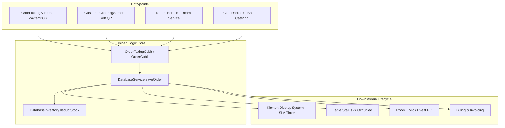

# Multi-Entrypoint Logic Linkage Matrix

> **Target Audience:** AI Agents & Architects  
> **Purpose:** Exhaustive mapping of actions and workflows triggered from multiple UI entrypoints to prevent logic fragmentation.

---

## 1. Executive Summary

In a complex hotel/restaurant management system like Sargon, critical domain operations (such as placing orders, settling bills, capturing guest info, or logging incidents) are initiated from multiple distinct screens and user personas. 

This matrix is the **single source of truth** for multi-entrypoint execution paths. Any agent modifying or adding an entrypoint **MUST** invoke the unified service/cubit contract mapped below.

---

## 2. Core Workflow Matrix

### Workflow 1: Order Placement & Modification

| Attribute | Details |
| :--- | :--- |
| **Trigger Entrypoints** | 1. **Dine-In POS**: `lib/features/orders/presentation/screens/order_taking_screen.dart` 2. **Customer QR Self-Ordering**: `lib/features/customer_ordering/presentation/screens/customer_ordering_screen.dart` 3. **Room Service**: `lib/features/rooms/ui/room_detail_screen.dart` $\to$ Order modal 4. **Private Event Catering**: `lib/features/events/presentation/screens/event_detail_screen.dart` $\to$ Add Food Order |
| **Shared Cubit / Methods** | - `OrderTakingCubit.submitOrder()` (`lib/features/orders/presentation/cubit/order_taking_cubit.dart`) - `CustomerOrderCubit.placeOrder()` (`lib/features/customer_ordering/presentation/cubit/customer_order_cubit.dart`) - `DatabaseOrders.saveOrder(Order order)` |
| **Required Entity Fields** | `hotelId`, `items[]`, `orderType` (`dineIn`, `roomService`, `takeaway`, `event`), `tableId` (if dine-in), `roomId` & `bookingId` (if room service), `eventId` (if event), `status: OrderStatus.pending` |
| **Downstream Side-Effects** | 1. **Table Status**: If `tableId != null`, updates `TableStatus.occupied`. 2. **KDS Tickets**: Emits ticket to KDS stream with courses (`starters`, `mains`, `desserts`). 3. **Stock Deduction**: Automatically triggers recipe-based stock deduction via `DatabaseInventory.deductStock()`. 4. **Room Folio**: If `bookingId != null`, links order to active `RoomFolio`. 5. **Order Merging**: If an active `pending` order already exists on the same table, new items are appended/merged rather than creating orphan split tickets. |

---

### Workflow 2: Billing, Discounts & Payment Settlement

| Attribute | Details |
| :--- | :--- |
| **Trigger Entrypoints** | 1. **Order History**: `lib/features/orders/presentation/screens/order_history_screen.dart` $\to$ Generate Bill 2. **Direct Billing**: `lib/features/billing/ui/screens/billing_screen.dart` 3. **Room Check-out**: `lib/features/rooms/ui/screens/checkout_screen.dart` (Folio settlement) 4. **Event Final Settlement**: `lib/features/events/presentation/screens/event_settlement_screen.dart` |
| **Shared Logic** | - `BillingCubit.createBill()` (`lib/features/billing/presentation/cubit/billing_cubit.dart`) - `DiscountCalculator.calculateTaxSummary()` (`lib/features/billing/logic/discount_calculator.dart`) - `DatabaseBilling.saveBill(Bill bill)` |
| **Required Entity Fields** | `hotelId`, `orderIds[]` or `folioId`, `customerId`, `taxSummary` (CGST, SGST, Service Charge), `discountAmount`, `payments[]`, `grandTotal` |
| **Downstream Side-Effects** | 1. **Table Transition**: Table status transitions to `TableStatus.cleaning` $\to$ Triggers Housekeeping Checklist. 2. **Payment Status**: Updates Order payment status to `PaymentStatus.paid` or `PaymentStatus.billToRoom`. 3. **Loyalty Engine**: If `customerId != null`, calculates earned points (e.g. 5% of subtotal) and updates `Customer.loyaltyInfo`. 4. **Audit Logging**: Emits `AuditLog` entry with cashier ID and payment breakdown. |

---

### Workflow 3: Customer Identification & Loyalty Linking

| Attribute | Details |
| :--- | :--- |
| **Trigger Entrypoints** | 1. **Order History**: `CustomerDetailsDialog` before bill creation. 2. **Order Taking**: Customer Phone Lookup in `OrderTakingScreen`. 3. **Room Guest Check-in**: `NewBookingDialog` in `RoomsScreen`. 4. **Event Host Capture**: `CreateEventScreen` in `EventsScreen`. 5. **Customer Management**: `CustomerListScreen` in `lib/features/staff_mgmt/`. |
| **Shared Logic** | - `CustomerCubit.lookupByPhone(String phone)` - `DatabaseCustomers.saveCustomer(Customer customer)` |
| **Required Entity Fields** | `phone` (E.164 via `AppPhoneField`), `name`, `hotelId`, `loyaltyInfo.availablePoints` |
| **Downstream Side-Effects** | 1. Links customer profile to `Order.customerId`, `Bill.customerId`, or `Booking.customerId`. 2. Enables real-time loyalty point redemption (`redeemedPoints`) during bill calculation. |

---

### Workflow 4: Housekeeping & Ops Checklist Auto-Generation

| Attribute | Details |
| :--- | :--- |
| **Trigger Entrypoints** | 1. **Table Billed**: Table status marked `cleaning` after dining settlement. 2. **Room Checkout**: Room status marked `dirty` / `cleaning` after guest departure. 3. **Shift Opening/Closing**: Scheduled trigger from `lib/features/checklists/`. |
| **Shared Logic** | - `ChecklistCubit.generateCleaningChecklist()` - `DatabaseChecklists.saveChecklist(Checklist checklist)` |
| **Downstream Side-Effects** | 1. Creates task for housekeeping staff with table/room number. 2. On checklist completion, table/room status automatically reverts to `available` (ready for seating/check-in). |

---

### Workflow 5: Incident & Loss Logging

| Attribute | Details |
| :--- | :--- |
| **Trigger Entrypoints** | 1. **Direct Incidents Screen**: `lib/features/incidents/ui/incident_report_screen.dart` 2. **Event Incident**: `lib/features/events/presentation/screens/event_incident_dialog.dart` 3. **Kitchen Spoilage / Breakage**: `lib/features/inventory/stock/ui/spoilage_dialog.dart` |
| **Shared Logic** | - `IncidentCubit.reportIncident()` - `DatabaseIncidents.saveIncident(Incident incident)` |
| **Downstream Side-Effects** | 1. Logs estimated financial cost. 2. In Events: Automatically adjusts event balance or logs vendor penalty. 3. In Inventory: Automatically deducts broken/spoiled stock quantities with reason `incident`. |

---

## 3. Implementation Rules for New Entrypoints

1. **Never Duplicate Business Logic**: When creating a new screen that allows placing orders or generating invoices, **always** reuse `OrderTakingCubit` or call `DatabaseService` methods.
2. **Always Propagate Multi-Tenant ID**: Extract `hotelId` via `context.hotelId` and pass it to every cubit method.
3. **Always Update Downstream Subscribers**: Ensure Firestore streams (`streamOrders`, `streamTables`, `streamBills`) are refreshed so all active screens update reactively.
