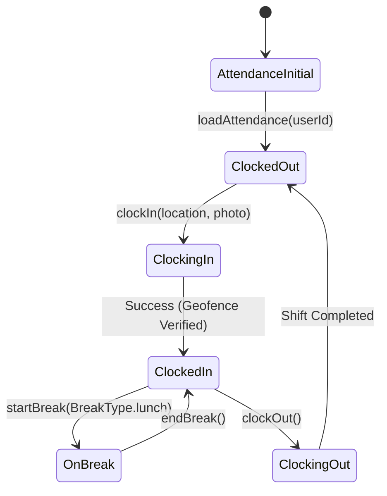

# Module: Attendance (`attendance`)

> **Module Path:** `lib/features/attendance/`  
> **Status:** Active  
> **Clean Architecture:** Yes  
> **Graphify Community:** HR & Operations

---

## 1. Overview & Business Domain

The `attendance` module tracks employee work hours, punctuality, and geofenced clock-ins:
- **Geofenced Clock-In/Out**: Verifies GPS coordinates against property geofence bounds.
- **Selfie Verification**: Optional photo verification for clock-in integrity.
- **Break Tracking**: Meal breaks, tea breaks, and total productive hours.
- **Manager Overrides**: Manual attendance adjustments with audit tracking.

---

## 2. Architecture & File Map

```
lib/features/attendance/
├── presentation/
│   ├── cubit/
│   │   ├── attendance_cubit.dart
│   │   └── attendance_state.dart
│   ├── screens/
│   │   ├── attendance_screen.dart         # Main staff clock-in / history dashboard
│   │   ├── attendance_summary_screen.dart # Manager team attendance matrix
│   │   └── manual_entry_screen.dart       # Manager override dialog
│   └── widgets/
│       ├── clock_in_button.dart
│       ├── attendance_calendar_view.dart
│       └── geofence_status_badge.dart
```

---

## 3. Data Layer & Firebase Contracts

- **Centralized Model**: `lib/core/models/hr_models.dart` (`AttendanceRecord`, `ClockEvent`, `AttendanceStatus`)
- **Service**: `lib/core/services/database/database_users.dart` & `lib/core/services/location_service.dart`
- **Firebase Path**: `/hotels/{hotelId}/attendance/{recordId}`
- **Tenancy**: Strictly isolated by `hotelId` and filtered by `userId`.

---

## 4. State Management (`AttendanceCubit`)



---

## 5. Cross-Module Dependencies

- **Inbound**:
  - `auth`: Prompts clock-in upon daily initial login.
- **Outbound**:
  - `performance`: Feeds shift duration and punctuality into staff performance metrics.
  - `audit`: Logs manual overrides and geofence bypasses.

---

## 6. AI Agent Implementation Recipes

### Geofence Clock-in Rule:
Before invoking `AttendanceCubit.clockIn()`, always call `LocationService.isWithinGeofence(hotelCoordinates)` to ensure location validity.
