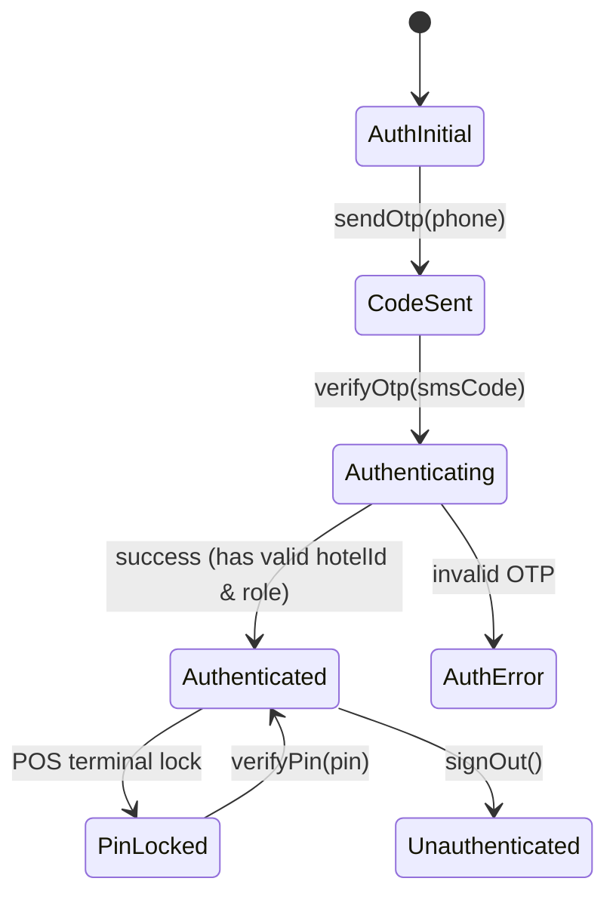

# Module: Authentication (`auth`)

> **Module Path:** `lib/features/auth/`  
> **Status:** Active  
> **Clean Architecture:** Yes  
> **Graphify Community:** Core Security & Auth

---

## 1. Overview & Business Domain

The `auth` module provides enterprise authentication and role-based authorization for Sargon App:
- **Phone OTP Verification**: Multi-region phone OTP login via Firebase Authentication.
- **PIN Verification**: Quick 4-digit/6-digit PIN login for shared staff POS terminals.
- **Role-Based Guards**: Enforces role access (`Admin`, `Manager`, `Cashier`, `Waiter`, `Chef`, `Housekeeping`).
- **Multi-Tenant Association**: Links authenticated users to their active `hotelId`.

---

## 2. Architecture & File Map

```
lib/features/auth/
├── cubit/
│   ├── auth_cubit.dart            # Handles phone OTP, PIN verification, session state
│   └── auth_state.dart            # AuthInitial, AuthLoading, Authenticated, Unauthenticated, AuthError
├── screens/
│   ├── login_screen.dart          # Phone number login & OTP input screen
│   └── pin_login_screen.dart      # Quick POS staff switch PIN keypad
└── widgets/
    ├── otp_input_field.dart       # 6-digit styled OTP box
    └── phone_input_card.dart      # AppPhoneField container with country picker
```

---

## 3. Data Layer & Firebase Contracts

- **Centralized Model**: `lib/core/models/user_model.dart` (`User`, `UserRole`)
- **Service**: `lib/core/services/auth_service.dart`
- **Firebase Path**: `/hotels/{hotelId}/users/{userId}`
- **Security Rule**:
  ```javascript
  match /hotels/{hotelId}/users/{userId} {
    allow read: if isAuthenticated() && request.auth.uid == userId;
    allow write: if hasRole('admin') || hasRole('owner');
  }
  ```

---

## 4. State Management (`AuthCubit`)



---

## 5. Cross-Module Dependencies

- **Inbound**: Every screen and module reads `AuthCubit` to obtain `currentUserId`, `userRole`, and `hotelId`.
- **Outbound**:
  - `Attendance`: Auto-prompts clock-in upon morning login.
  - `Audit`: Logs `LOGIN_SUCCESS`, `LOGIN_FAILURE`, and `ROLE_SWITCH`.

---

## 6. Graphify Shortcuts

```bash
graphify query "How does AuthCubit interact with AuthService and handle multi-tenant hotelId?"
graphify explain "AuthCubit"
```

---

## 7. AI Agent Implementation Recipes

### How to add a new user role:
1. Update `UserRole` enum in `lib/core/models/user_model.dart`.
2. Update role mapping and permissions in `lib/core/auth/role_guard.dart`.
3. Add role-specific route redirect in `lib/core/navigation/app_router.dart`.
4. Update `firestore.rules` helper function `hasRole()`.
