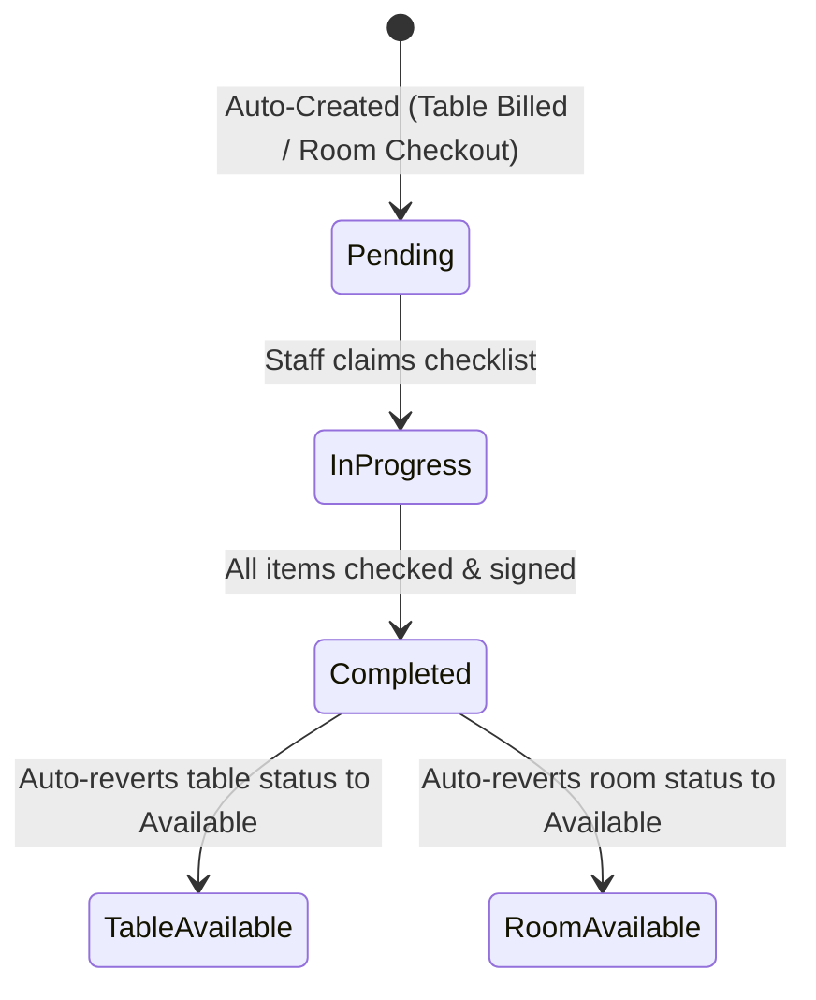

# Module: Checklists (`checklists`)

> **Module Path:** `lib/features/checklists/`  
> **Status:** Active  
> **Clean Architecture:** Yes  
> **Graphify Community:** Operations & Housekeeping

---

## 1. Overview & Business Domain

The `checklists` module automates operational quality checks and table/room cleaning lifecycles:
- **Table Cleaning Lifecycle**: Triggered automatically when a dining table status moves to `TableStatus.cleaning`.
- **Room Housekeeping Lifecycle**: Triggered upon guest checkout to sanitize and inspect room amenities.
- **Daily Shift Checklists**: Kitchen opening, bar closing, hygiene inspections.
- **Auto-Reversion**: Completing the cleaning checklist automatically sets table/room status back to `Available`.

---

## 2. Architecture & File Map

```
lib/features/checklists/
├── presentation/
│   ├── cubit/
│   │   ├── checklist_cubit.dart       # Active checklists & completion state
│   │   └── checklist_state.dart
│   ├── screens/
│   │   ├── checklist_list_screen.dart # Pending vs completed checklist queues
│   │   ├── checklist_execution_screen.dart # Step-by-step checklist task runner
│   │   └── checklist_templates_screen.dart # Admin checklist template builder
│   └── widgets/
│       ├── checklist_item_tile.dart
│       ├── photo_attachment_box.dart
│       └── progress_summary_bar.dart
```

---

## 3. Data Layer & Firebase Contracts

- **Centralized Model**: `lib/core/models/operations_models.dart` (`Checklist`, `ChecklistItem`, `ChecklistType`, `ChecklistStatus`)
- **Service**: `lib/core/services/database/database_checklists.dart`
- **Firebase Path**: `/hotels/{hotelId}/checklists/{checklistId}`

---

## 4. State Management Flow



---

## 5. Cross-Module Dependencies

- **Inbound**:
  - `billing` & `orders`: Trigger cleaning checklist when order is settled.
  - `rooms`: Triggers room cleaning checklist upon checkout.
- **Outbound**:
  - `table_mgmt`: Updates table status to `Available`.
  - `rooms`: Updates room status to `Available`.
  - `performance`: Records housekeeping duration.
