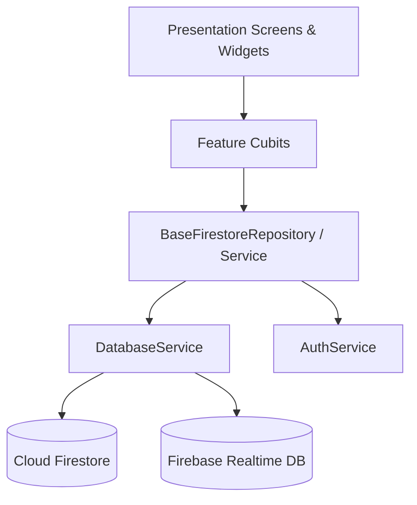

# Core Services & Architecture Specification

> **Target Audience:** AI Agents & Core Contributors  
> **Source Directory:** `lib/core/services/` & `lib/core/models/`  
> **Graphify Community:** Infrastructure / Foundation

---

## 1. Overview & Architectural Role

The core layer houses centralized singleton services, base entities, multi-tenancy enforcement, and global data providers. **No feature module should define its own domain models or direct Firestore client connections.** All communication goes through `DatabaseService`, `AuthService`, or domain-specific repositories extending `BaseFirestoreRepository`.



---

## 2. Global Services Directory (`lib/core/services/`)

| Service | File Path | Primary Responsibilities | Key Methods |
| :--- | :--- | :--- | :--- |
| **DatabaseService** | `lib/core/services/database_service.dart` | Central Firestore gateway using sub-service parts | `hotelDoc(hotelId)`, `saveOrder()`, `streamOrders()`, `saveBill()`, `streamTables()` |
| **AuthService** | `lib/core/services/auth_service.dart` | Phone OTP authentication, role verification, token management | `verifyPhoneNumber()`, `signInWithCredential()`, `getCurrentUser()`, `signOut()` |
| **AuditService** | `lib/core/services/audit_service.dart` | Structured audit logging for security, operations, and compliance | `logActivity()`, `streamAuditLogs()`, `getLogsByEntity()` |
| **NotificationService** | `lib/core/services/notification_service.dart` | Local notifications, push notification dispatch, sound/vibration alerts | `showNotification()`, `initialize()`, `cancelAll()` |
| **PdfService** | `lib/core/services/pdf_service.dart` | Printing & PDF document generation for invoices, KOT tickets, reports | `generateBillPdf()`, `generateKotPdf()`, `printDocument()` |
| **LocationService** | `lib/core/services/location_service.dart` | Geolocation verification for staff attendance and delivery boundaries | `getCurrentLocation()`, `isWithinGeofence()` |
| **StorageService** | `lib/core/services/storage/` | Firebase Storage uploads for receipts, menu images, room photos | `uploadFile()`, `getDownloadUrl()`, `deleteFile()` |

---

## 3. DatabaseService Modular Sub-Parts

`DatabaseService` employs Dart `part` / `part of` files located in `lib/core/services/database/`:
- `database_orders.dart` — Order creation, status transitions (`pending` $\to$ `fired` $\to$ `preparing` $\to$ `ready` $\to$ `served`), SLA calculation.
- `database_billing.dart` — Bills, folio settlements, dynamic tax rules, service charges.
- `database_tables.dart` — Table CRUD, occupancy state, table joining, pax mapping.
- `database_rooms.dart` — Room inventory, check-in/check-out lifecycle, folio linking.
- `database_inventory.dart` — Real-time stock deduction, GRN (Goods Receipt), PO syncing.
- `database_checklists.dart` — Operational checklist templates, task assignments, auto-generation.
- `database_customers.dart` — CRM records, loyalty points accumulation, lifetime spend tracking.
- `database_events.dart` — Banquet bookings, hall scheduling, live quotation calculation.
- `database_loyalty.dart` — Loyalty tier configs, points conversion, redemption history.
- `database_offers.dart` — Coupon codes, happy hour schedules, order discount rules.
- `database_users.dart` — Staff accounts, role assignments, pin codes, permissions.
- `database_incidents.dart` — Loss reporting, security incidents, cost implications.

---

## 4. Centralized Domain Models (`lib/core/models/`)

All domain entities extend `BaseEntity` (`lib/core/models/base_entity.dart`).

```dart
abstract class BaseEntity {
  final String id;
  final String hotelId;
  final DateTime createdOn;
  final String createdBy;
  final DateTime updatedOn;
  final String updatedBy;
  final bool isDeleted;
  ...
}
```

### Model Directory Index
1. `order_model.dart` / `ordering_models.dart`: `Order`, `OrderItem`, `OrderStatus`, `KdsStatus`, `OrderType`.
2. `billing_models.dart` / `payment_models.dart`: `Bill`, `BillTaxSummary`, `Payment`, `PaymentMethod`, `TaxRule`, `ServiceChargeRule`, `RoomFolio`.
3. `restaurant_models.dart`: `TableEntity`, `TableStatus`, `MenuItem`, `MenuCategory`, `MenuAddon`.
4. `room_model.dart` / `booking_model.dart`: `Room`, `RoomType`, `RoomStatus`, `Booking`, `GuestDetails`.
5. `crm_models.dart` / `promotion_models.dart`: `Customer`, `LoyaltyInfo`, `LoyaltyTier`, `Offer`, `OfferType`.
6. `inventory_models.dart` / `purchase_models.dart`: `InventoryItem`, `StockTransaction`, `PurchaseOrder`, `Vendor`, `GoodsReceipt`.
7. `operations_models.dart`: `Checklist`, `ChecklistItem`, `ChecklistStatus`, `Incident`, `IncidentSeverity`.
8. `hr_models.dart` / `user_model.dart`: `User`, `UserRole`, `AttendanceRecord`, `StaffShift`.
9. `event_models.dart`: `PrivateEvent`, `EventHall`, `EventQuote`, `EventStatus`.

---

## 5. Multi-Tenancy & Security Rules (`hotelId`)

### Non-Negotiable Tenancy Rules:
1. **Never hardcode `hotelId`**: Access via `context.hotelId` or pass down from the authenticated session.
2. **Firestore Hierarchy**: All multi-tenant data is isolated under:
   ```
   /hotels/{hotelId}/{collection}/{docId}
   ```
3. **Soft Delete Protocol**: Every query must filter `where('isDeleted', isEqualTo: false)`. Never call `doc.delete()` unless executing an explicit hard-purge admin action.
4. **Audit Propagation**: When calling `save<Entity>()`, automatically stamp `updatedOn = DateTime.now()` and `updatedBy = currentUserId`.

---

## 6. Graphify Shortcuts for Agents

```bash
# Query the entire database service hierarchy
graphify query "How does DatabaseService persist orders and update inventory?"

# Find shortest path from UI to Firestore
graphify path "OrderTakingScreen" "DatabaseService"

# Explain BaseEntity inheritance
graphify explain "BaseEntity"
```
