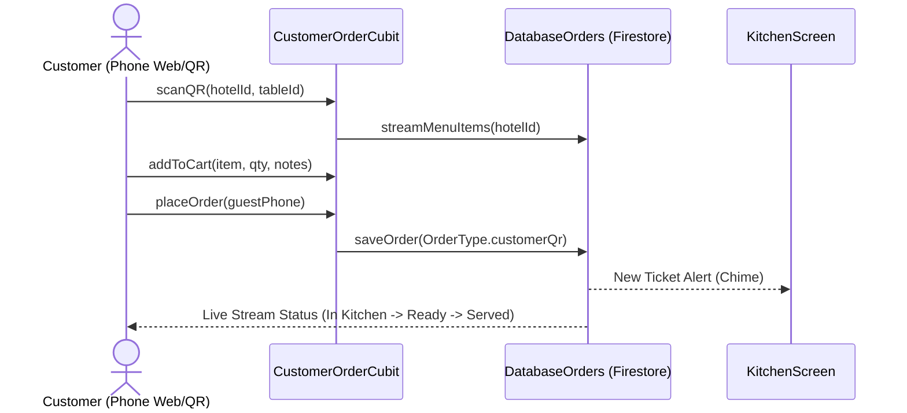

# Module: Customer Self-Ordering (`customer_ordering`)

> **Module Path:** `lib/features/customer_ordering/`  
> **Status:** Active (New Self-Service Channel)  
> **Clean Architecture:** Yes  
> **Graphify Community:** Customer Channels & Public Web/QR

---

## 1. Overview & Business Domain

The `customer_ordering` module provides a lightweight, customer-facing digital menu and self-ordering interface accessed via table QR code or public web link:
- **QR Code Table Association**: Scanned QR code automatically locks table number and hotel context.
- **Visual Digital Menu**: High-res menu photography, allergen warnings, spice level tags, and descriptions.
- **Self-Checkout Cart**: Customer selects quantities, adds preparation notes (e.g., "no onions"), applies coupon codes, and submits.
- **Direct KDS Pipeline**: Orders land straight on the Kitchen Display System without waiting for a waiter.
- **Live Order Status Tracker**: Real-time progress bar showing order status (`Received` $\to$ `In Kitchen` $\to$ `Ready` $\to$ `Delivered`).

---

## 2. Architecture & File Map

```
lib/features/customer_ordering/
├── presentation/
│   ├── cubit/
│   │   ├── customer_order_cubit.dart  # Public cart state, promo code application, order submission
│   │   └── customer_order_state.dart
│   ├── screens/
│   │   ├── customer_menu_screen.dart  # Mobile-first customer menu browsing screen
│   │   ├── customer_cart_screen.dart  # Item review, guest contact, promo code, place order
│   │   └── customer_status_screen.dart# Real-time visual tracking screen
│   └── widgets/
│       ├── customer_item_tile.dart    # Visual card with quantity counters
│       ├── dietary_filter_chips.dart  # Veg, Vegan, Gluten-Free, Chef Special filters
│       └── order_tracker_stepper.dart # Step progress indicator
```

---

## 3. Data Layer & Firebase Contracts

- **Centralized Models**:
  - `lib/core/models/ordering_models.dart` (`Order`, `OrderItem`, `OrderType.customerQr`)
  - `lib/core/models/restaurant_models.dart` (`MenuItem`, `MenuCategory`)
- **Service**: `lib/core/services/database/database_orders.dart`
- **Firebase Path**: `/hotels/{hotelId}/orders/{orderId}` (Tagged with `orderType: OrderType.customerQr`)
- **Security Rule**: Public read allowed on `/hotels/{hotelId}/menu_items`; write allowed on `/hotels/{hotelId}/orders` with schema validation.

---

## 4. State Management Flow



---

## 5. Cross-Module Dependencies

- **Inbound**: Deep-link URL `/order/:hotelId/:tableId`.
- **Outbound**:
  - `orders` (KDS): Tickets immediately show on kitchen screens with table number.
  - `table_mgmt`: Sets table status to `occupied`.
  - `loyalty`: Recognizes registered customer phone and applies loyalty rewards.
