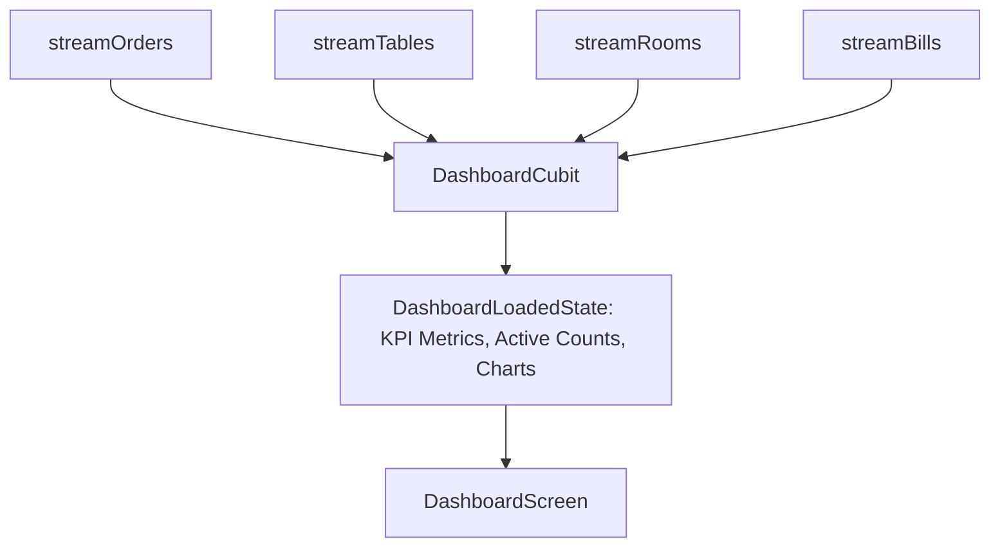

# Module: Dashboard (`dashboard`)

> **Module Path:** `lib/features/dashboard/`  
> **Status:** Active  
> **Clean Architecture:** Yes  
> **Graphify Community:** Analytics & Main Landing

---

## 1. Overview & Business Domain

The `dashboard` module is the primary operational landing hub for Sargon App:
- **Role-Based Metric Aggregation**: Tailored KPI views for Owners, General Managers, Cashiers, Chefs, and Waiters.
- **Real-Time Revenue Stats**: Today's Sales, Occupancy %, Active Tables, Open Orders, Average Turnaround Time.
- **Quick Action Bar**: Shortcuts to New Order, New Booking, KDS, Room Status, and Stock Alerts.
- **Live Activity Feed**: Real-time ticker of recent orders, check-ins, and pending checklists.

---

## 2. Architecture & File Map

```
lib/features/dashboard/
├── cubit/
│   ├── dashboard_cubit.dart       # Aggregates streams from Orders, Tables, Rooms, Bills
│   └── dashboard_state.dart       # DashboardInitial, DashboardLoading, DashboardLoaded, DashboardError
├── screens/
│   ├── dashboard_screen.dart      # Main responsive dashboard (desktop/tablet/mobile)
│   └── cashier_dashboard.dart     # Focused POS register dashboard
└── widgets/
    ├── kpi_metric_card.dart       # Revenue, Occupancy, Order count cards
    ├── quick_action_grid.dart     # POS shortcut buttons
    ├── live_order_ticker.dart     # Real-time order status scroll
    └── occupancy_radial_chart.dart # Visual occupancy gauge
```

---

## 3. Data Layer & Stream Aggregation

- **Data Sources**: Aggregates streams from:
  - `DatabaseOrders.streamOrders(hotelId)`
  - `DatabaseTables.streamTables(hotelId)`
  - `DatabaseRooms.streamRooms(hotelId)`
  - `DatabaseBilling.streamBills(hotelId)`
- **Safe Type Casting**: Firestore snapshot records are safely mapped to prevent `LinkedMap` vs `Map<String, dynamic>` casting errors.

---

## 4. State Management Flow (`DashboardCubit`)



---

## 5. Cross-Module Dependencies

- **Inbound**: Top-level route `/dashboard` upon successful login.
- **Outbound**: Navigates to all primary feature modules:
  - `/order-taking`
  - `/order-history`
  - `/tables`
  - `/rooms`
  - `/kitchen`
  - `/inventory`
