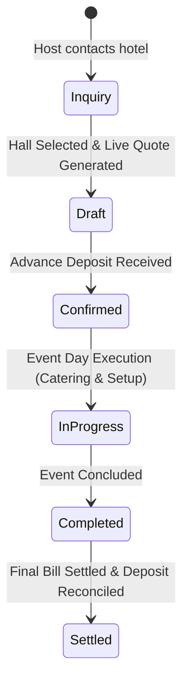

# Module: Private Events & Banquets (`events`)

> **Module Path:** `lib/features/events/`  
> **Status:** Active (Enhanced)  
> **Clean Architecture:** Yes  
> **Graphify Community:** Banquets & Event Intelligence

---

## 1. Overview & Business Domain

The `events` module orchestrates private banquets, weddings, conferences, and party bookings:
- **Hall Multi-Selection**: Book single or multiple banquet halls for a single event with aggregate capacity validations.
- **Proactive Conflict Detection**: Real-time checking of hall availability to prevent double-bookings.
- **Live Quote Estimator**: Instant dynamic calculation of Base Hall Rent + Per-Pax Catering + Addon Services (DJ, Decor, Lighting).
- **Vendor PO Sync**: Tracking external vendor costs directly tied to the event bill.
- **Event Incident Logging**: Logging damage or operational incidents with direct financial impact on the deposit balance.

---

## 2. Architecture & File Map

```
lib/features/events/
├── presentation/
│   ├── cubit/
│   │   ├── event_cubit.dart           # Event booking lifecycle, quote estimation, hall scheduling
│   │   └── event_state.dart
│   ├── screens/
│   │   ├── events_dashboard_screen.dart # Calendar timeline & list of upcoming banquets
│   │   ├── create_event_screen.dart   # Wizard for hall selection, date, pax, catering menu
│   │   ├── event_detail_screen.dart   # Full event overview, quote breakdown, vendor POs, incidents
│   │   └── event_settlement_screen.dart # Advance deposit deduction, final invoice generation
│   └── widgets/
│       ├── event_card.dart
│       ├── hall_multi_selector.dart
│       ├── live_quote_card.dart
│       └── event_incident_dialog.dart
```

---

## 3. Data Layer & Firebase Contracts

- **Centralized Models**: `lib/core/models/event_models.dart` (`PrivateEvent`, `EventHall`, `EventQuote`, `EventStatus`, `EventAddon`)
- **Service**: `lib/core/services/database/database_events.dart`
- **Firebase Paths**:
  - `/hotels/{hotelId}/events/{eventId}`
  - `/hotels/{hotelId}/event_halls/{hallId}`

---

## 4. State Management Flow



---

## 5. Cross-Module Dependencies

- **Inbound**:
  - `staff_mgmt`: Host customer details linked to CRM.
- **Outbound**:
  - `billing`: `EventSettlementScreen` triggers `BillingCubit` for invoice generation.
  - `inventory`: Banquet vendor POs link into `purchase_orders`.
  - `incidents`: Damages during event log to `incidents` module.
