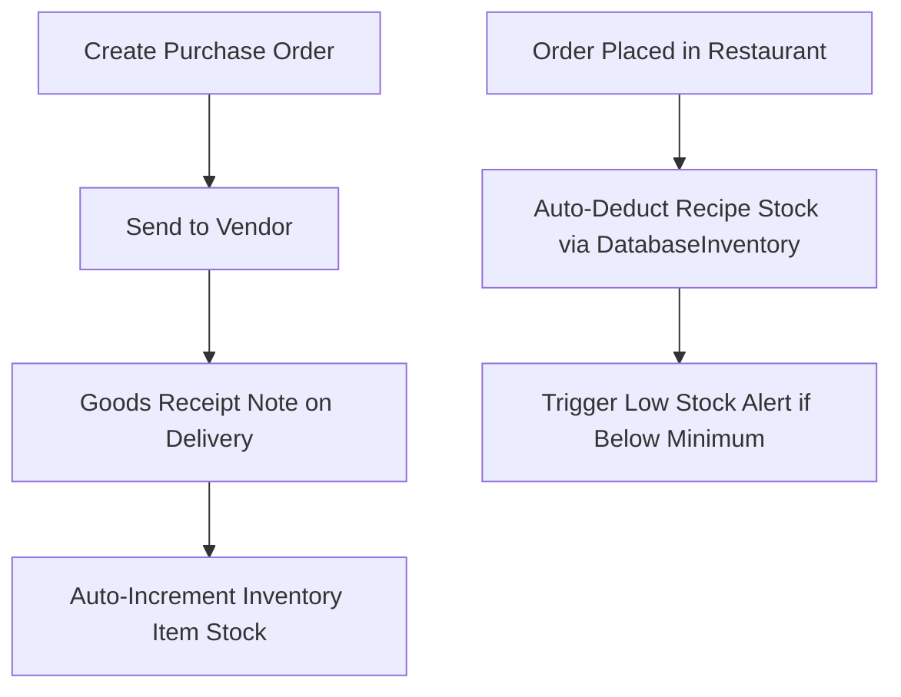

# Module: Inventory & Supply Chain (`inventory`)

> **Module Path:** `lib/features/inventory/`  
> **Status:** Active (Refactored Sub-Modules)  
> **Clean Architecture:** Yes  
> **Graphify Community:** Supply Chain & Stock Management

---

## 1. Overview & Business Domain

The `inventory` module provides complete supply chain management across 4 dedicated sub-modules:
1. **Stock Management (`stock`)**: Raw materials, ingredients, bar inventory, minimum reorder thresholds, and recipe links.
2. **Goods Receipt Note (`goods_receipt` / GRN)**: Inward verification of delivered goods, quantity checks, price variances.
3. **Purchase Orders (`purchase_orders` / PO)**: PO generation, vendor approval workflows, and status tracking (`Draft`, `Ordered`, `Partial`, `Received`).
4. **Vendors (`vendors`)**: Supplier directory, credit terms, contact details, payment records.

---

## 2. Architecture & File Map

```
lib/features/inventory/
├── stock/
│   ├── presentation/
│   │   ├── cubit/inventory_cubit.dart
│   │   └── ui/stock_list_screen.dart, stock_detail_screen.dart
├── goods_receipt/
│   ├── presentation/
│   │   ├── cubit/goods_receipt_cubit.dart
│   │   └── ui/goods_receipt_screen.dart, grn_form_screen.dart
├── purchase_orders/
│   ├── presentation/
│   │   ├── cubit/purchase_order_cubit.dart
│   │   └── ui/po_list_screen.dart, create_po_screen.dart
└── vendors/
    ├── presentation/
    │   ├── cubit/vendor_cubit.dart
    │   └── ui/vendor_list_screen.dart, vendor_detail_screen.dart
```

---

## 3. Data Layer & Firebase Contracts

- **Centralized Models**:
  - `lib/core/models/inventory_models.dart` (`InventoryItem`, `StockTransaction`, `StockUnit`)
  - `lib/core/models/purchase_models.dart` (`PurchaseOrder`, `POLineItem`, `Vendor`, `GoodsReceipt`)
- **Service**: `lib/core/services/database/database_inventory.dart`
- **Firebase Paths**:
  - `/hotels/{hotelId}/inventory/{itemId}`
  - `/hotels/{hotelId}/purchase_orders/{poId}`
  - `/hotels/{hotelId}/vendors/{vendorId}`
  - `/hotels/{hotelId}/goods_receipts/{grnId}`

---

## 4. State Management Flow



---

## 5. Cross-Module Dependencies

- **Inbound**:
  - `orders`: Automatically deducts recipe quantities via `DatabaseInventory.deductStock()`.
  - `events`: External banquet vendor POs link into event billing.
  - `incidents`: Spoilage or breakage logs auto-deduct stock.
