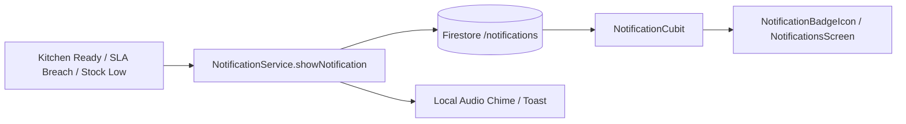

# Module: Notifications (`notifications`)

> **Module Path:** `lib/features/notifications/`  
> **Status:** Active  
> **Clean Architecture:** Yes  
> **Graphify Community:** Messaging & Alerts

---

## 1. Overview & Business Domain

The `notifications` module handles in-app alerts, audio chimes, and push notifications for urgent hospitality events:
- **Kitchen Alerts**: Order fired chime, order ready for pickup notification to servers.
- **SLA Breach Warnings**: Alert when an order ticket exceeds 15 minutes preparation time.
- **Housekeeping Assignments**: Cleaning checklist assigned to staff.
- **Low Stock Warnings**: Inventory alerts when items reach reorder levels.

---

## 2. Architecture & File Map

```
lib/features/notifications/
├── presentation/
│   ├── cubit/
│   │   ├── notification_cubit.dart    # Stream of user/role-targeted alerts
│   │   └── notification_state.dart
│   ├── screens/
│   │   └── notifications_screen.dart  # Notification center with read/unread tabs
│   └── widgets/
│       ├── notification_tile.dart
│       └── notification_badge_icon.dart
```

---

## 3. Data Layer & Firebase Contracts

- **Centralized Model**: `lib/core/models/notification_model.dart` (`AppNotification`, `NotificationType`, `NotificationPriority`)
- **Service**: `lib/core/services/notification_service.dart`
- **Firebase Path**: `/hotels/{hotelId}/notifications/{notificationId}`

---

## 4. State Management Flow



---

## 5. Cross-Module Dependencies

- **Inbound Sources**: `orders` (KDS), `checklists` (Housekeeping), `inventory` (Low Stock), `events` (Payment Due).
