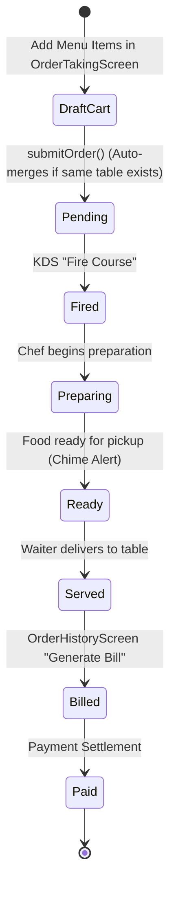

# Module: Orders (`orders`)

> **Module Path:** `lib/features/orders/`  
> **Status:** Active (Enhanced Production-Ready)  
> **Clean Architecture:** Yes  
> **Graphify Community:** Core Revenue & Kitchen Display System

---

## 1. Overview & Business Domain

The `orders` module is the beating heart of restaurant POS operations in Sargon App:
- **Responsive Menu Ordering**: 3-column menu grid with category filter, live search, addons, and notes.
- **Table Order Auto-Merging**: Seamlessly merges new items into pending orders on the same table rather than generating disconnected duplicate tickets.
- **Production Kitchen Display System (KDS)**: Modular ticket display with item status progression (`FIRE` $\to$ `PREP` $\to$ `READY` $\to$ `SERVED`).
- **Course Intelligence**: Granular stage management of Starters, Main Course, Desserts, and Drinks.
- **Real-Time SLA Enforcement**: Live SLA timer per course with visual delay warning bars (>15 mins).
- **Guest Pax Tracking**: Records guest headcount per order for yield analytics and table seating efficiency.

---

## 2. Architecture & File Map

```
lib/features/orders/
├── presentation/
│   ├── cubit/
│   │   ├── order_taking_cubit.dart    # Cart state, item notes, course selection, submit
│   │   ├── order_cubit.dart           # Active order lifecycle, status updates, voiding
│   │   └── order_history_cubit.dart   # Filterable order history, KDS status, bill generation
│   ├── screens/
│   │   ├── order_taking_screen.dart   # POS Menu ordering & cart interface
│   │   ├── order_history_screen.dart  # Active & completed orders with actions (Bill, Offer, Pay)
│   │   ├── kitchen_screen.dart        # Digital KDS Ticket Grid for Chefs & Expeditors
│   │   └── order_detail_screen.dart   # Deep order audit & item breakdown
│   └── widgets/
│       ├── menu_item_card.dart        # Image, price, veg/non-veg badge, add button
│       ├── order_cart_sidebar.dart    # Course grouping, item notes, submit button
│       ├── kds_ticket_card.dart       # Ticket header, SLA bar, course status toggles
│       ├── apply_offer_dialog.dart    # Active promo code / offer selection modal
│       └── course_selector_tabs.dart  # Starters, Mains, Desserts filter tabs
```

---

## 3. Data Layer & Firebase Contracts

- **Centralized Models**:
  - `lib/core/models/ordering_models.dart` (`Order`, `OrderItem`, `OrderStatus`, `KdsStatus`, `OrderType`, `CourseType`)
  - `lib/core/models/restaurant_models.dart` (`MenuItem`, `MenuCategory`, `TableEntity`)
- **Service**: `lib/core/services/database/database_orders.dart`
- **Firebase Path**: `/hotels/{hotelId}/orders/{orderId}`
- **Multi-Tenancy**: Isolated under `/hotels/{hotelId}/orders/`. Query always filters `isDeleted: false`.

---

## 4. State Management & Lifecycle Flow



---

## 5. Cross-Module Dependencies & Shared Workflows

- **Inbound Trigger Points**:
  - `table_mgmt`: Selecting table navigates to `OrderTakingScreen(tableId)`.
  - `rooms`: Room service ordering embeds order taking.
  - `events`: Banquet meal ordering feeds into `OrderTakingCubit`.
- **Outbound Downstream**:
  - `table_mgmt`: Sets `TableStatus.occupied` upon order submission.
  - `inventory`: Calls `DatabaseInventory.deductStock()` for recipe ingredients.
  - `billing`: `OrderHistoryScreen` triggers `BillingCubit.createBill()`.
  - `performance`: Records preparation timestamps for SLA analytics.

---

## 6. Graphify Shortcuts

```bash
graphify query "Trace how an order moves from OrderTakingCubit to KDS and Billing"
graphify path "OrderTakingScreen" "KitchenScreen"
graphify explain "OrderTakingCubit"
```

---

## 7. AI Agent Implementation Recipes

### Auto-Merging Rule:
When adding items to an existing open table, never overwrite `order.id`. Check `existingOrder.status == OrderStatus.pending`, append new items with their respective course types, and call `DatabaseOrders.saveOrder()`.
