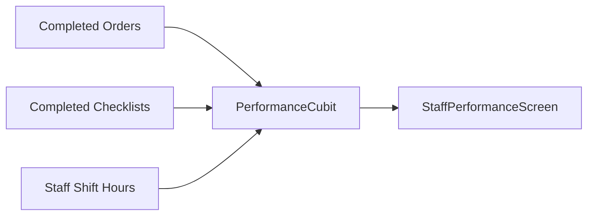

# Module: Performance (`performance`)

> **Module Path:** `lib/features/performance/`  
> **Status:** Active  
> **Clean Architecture:** Yes  
> **Graphify Community:** Analytics & Staff Efficiency

---

## 1. Overview & Business Domain

The `performance` module analyzes operational speed, staff efficiency, and service quality:
- **Kitchen SLA Tracking**: Average preparation time per course (Starters vs Mains), delayed ticket % (>15 min SLA threshold).
- **Server & Waiter Turnaround**: Orders placed per server, average table seating duration, upsell revenue.
- **Housekeeping Turnaround**: Average cleaning duration per room/table from status `dirty`/`cleaning` to `available`.
- **Rankings & Leaderboards**: Top performing servers and chefs based on speed and positive feedback.

---

## 2. Architecture & File Map

```
lib/features/performance/
├── presentation/
│   ├── cubit/
│   │   ├── performance_cubit.dart
│   │   └── performance_state.dart
│   ├── screens/
│   │   └── staff_performance_screen.dart # Performance charts, SLA metrics, leaderboards
│   └── widgets/
│       ├── sla_trend_chart.dart
│       ├── staff_rank_card.dart
│       └── department_efficiency_gauge.dart
```

---

## 3. Data Layer & Formulas

- **Data Aggregation**: Reads from completed `Order`, `Checklist`, and `AttendanceRecord` histories.
- **Formulas**:
  - `Kitchen SLA Compliance % = (Total Tickets Prepared Within SLA / Total Tickets) * 100`
  - `Table Turnover Rate = Total Completed Table Sessions / Total Tables`
  - `Housekeeping Speed = Average (Checklist.completedOn - Checklist.createdOn)`

---

## 4. State Management Flow



---

## 5. Cross-Module Dependencies

- **Inbound**:
  - `orders` (KDS timestamps)
  - `checklists` (Task completion timestamps)
  - `attendance` (Staff productive hours)
