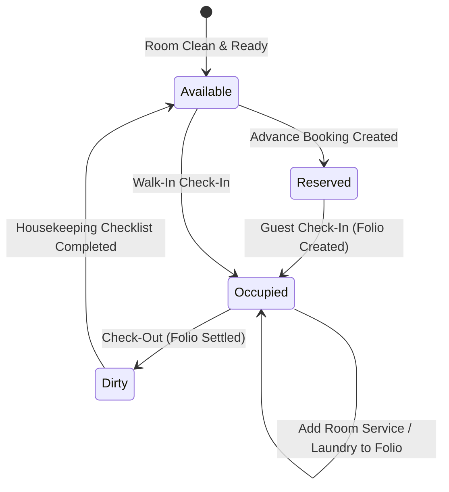

# Module: Rooms & Front Desk (`rooms`)

> **Module Path:** `lib/features/rooms/`  
> **Status:** Active (Refactored to Cubit $\to$ Repository Pattern)  
> **Clean Architecture:** Yes  
> **Graphify Community:** Property Management & Guest Lodging

---

## 1. Overview & Business Domain

The `rooms` module manages hotel room inventory, reservations, guest check-in/out, and room folios:
- **Room Grid & Occupancy Matrix**: Real-time room status (`Available`, `Occupied`, `Reserved`, `Maintenance`, `Dirty`/`Cleaning`).
- **Reservation & Check-In**: Captures guest details, ID proof, advance deposit, and dates.
- **Room Folio Management**: Aggregates room tariff, room service dining orders, laundry, and mini-bar charges onto a single folio.
- **Bill-to-Room POS Integration**: Waiters can charge restaurant meals directly to an active room booking.
- **Check-Out & Folio Settlement**: Generates master hotel invoice and triggers housekeeping cleaning.

---

## 2. Architecture & File Map

```
lib/features/rooms/
├── data/
│   └── repositories/
│       └── room_repository.dart       # Room CRUD, booking queries, folio management
├── presentation/ (or ui/)
│   ├── cubit/
│   │   ├── room_cubit.dart            # Room status streams, booking operations, folio state
│   │   └── room_state.dart
│   ├── screens/
│   │   ├── rooms_screen.dart          # Visual room grid with floor & room-type filters
│   │   ├── room_detail_screen.dart    # Active guest details, folio breakdown, action buttons
│   │   └── checkout_screen.dart       # Folio settlement, payments, key return
│   └── widgets/
│       ├── room_card.dart             # Room number, room type, guest name badge, status chip
│       ├── guest_checkin_dialog.dart  # Guest registration form with AppPhoneField
│       └── room_service_modal.dart    # Quick room service order launcher
```

---

## 3. Data Layer & Firebase Contracts

- **Centralized Models**:
  - `lib/core/models/room_model.dart` (`Room`, `RoomType`, `RoomStatus`)
  - `lib/core/models/booking_model.dart` (`Booking`, `BookingStatus`, `GuestDetails`)
  - `lib/core/models/billing_models.dart` (`RoomFolio`, `FolioCharge`)
- **Service**: `lib/core/services/database/database_rooms.dart`, `database_billing.dart`
- **Firebase Paths**:
  - `/hotels/{hotelId}/rooms/{roomId}`
  - `/hotels/{hotelId}/bookings/{bookingId}`
  - `/hotels/{hotelId}/folios/{folioId}`

---

## 4. State Management Flow



---

## 5. Cross-Module Dependencies

- **Inbound Trigger Points**:
  - `orders`: Room service orders attach `roomId` and `bookingId`.
  - `billing`: Folio checkout triggers `BillingCubit.createBill()`.
- **Outbound Downstream**:
  - `checklists`: Room checkout triggers room sanitization checklist.
  - `loyalty`: Awards points to guest based on total room + dining spend.
