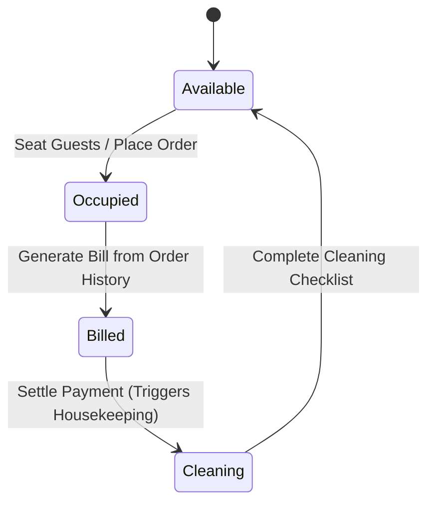

# Module: Table Management (`table_mgmt`)

> **Module Path:** `lib/features/table_mgmt/`  
> **Status:** Active  
> **Clean Architecture:** Yes  
> **Graphify Community:** Floor Operations & Seating Intelligence

---

## 1. Overview & Business Domain

The `table_mgmt` module orchestrates floor layout, seating capacity, and real-time dining lifecycle states:
- **Visual Floor Plan Grid**: Dynamic table cards color-coded by lifecycle state.
- **Automated Lifecycle Transitions**: `Available` $\to$ `Occupied` (Order placed) $\to$ `Billed` (Bill generated) $\to$ `Cleaning` (Payment completed) $\to$ `Available` (Checklist completed).
- **Table Joining & Merging**: Ability to join physical tables (e.g. T1 + T2) for large party dining.
- **Pax Intelligence**: Suggests optimal table fit based on guest count to prevent capacity wastage.

---

## 2. Architecture & File Map

```
lib/features/table_mgmt/
├── presentation/
│   ├── cubit/
│   │   ├── table_cubit.dart           # Real-time table streams, status changes, table joining
│   │   └── table_state.dart
│   ├── screens/
│   │   └── table_dashboard_screen.dart # Floor plan layout with section filters (Indoor, Patio, AC)
│   └── widgets/
│       ├── table_card.dart            # Table number, pax count, occupied timer, waiter badge
│       ├── join_tables_dialog.dart    # Multi-select tables to create combined session
│       └── pax_selector_dialog.dart   # Guest headcount input before seating
```

---

## 3. Data Layer & Firebase Contracts

- **Centralized Model**: `lib/core/models/restaurant_models.dart` (`TableEntity`, `TableStatus`, `TableShape`, `TableSection`)
- **Service**: `lib/core/services/database/database_tables.dart`
- **Firebase Path**: `/hotels/{hotelId}/tables/{tableId}`

---

## 4. State Machine & Automated Transitions



---

## 5. Cross-Module Dependencies

- **Inbound**:
  - `orders`: Table selection launches `OrderTakingScreen(tableId)`.
  - `billing`: Payment settlement updates table to `Cleaning`.
  - `checklists`: Checklist completion reverts table to `Available`.
